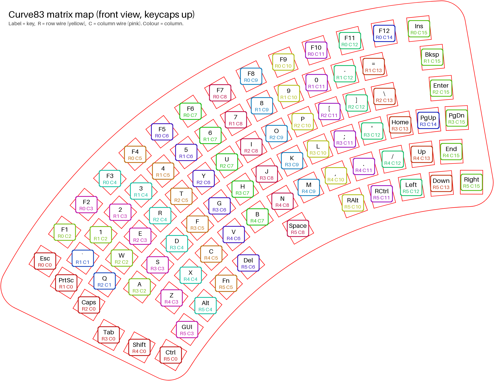

# Curve83

A curved one-handed 83-key keyboard with a trackpad, hand-wired (one diode per
switch) to a Raspberry Pi Pico (RP2040).

* Keyboard maintainer: [kev-wo](https://github.com/kev-wo)
* Hardware supported: Raspberry Pi Pico, Cirque Pinnacle trackpad (I2C)

Make example for this keyboard (after setting up your build environment):

    make curve83:default

Flashing example for this keyboard:

    make curve83:default:flash

See the [build environment setup](https://docs.qmk.fm/#/getting_started_build_tools) and the [make instructions](https://docs.qmk.fm/#/getting_started_make_guide) for more information. Brand new to QMK? Start with our [Complete Newbs Guide](https://docs.qmk.fm/#/newbs).

## Bootloader

Enter the bootloader in 3 ways:

* **Bootmagic reset**: Hold down Esc and plug in the keyboard
* **Physical reset button**: Hold BOOTSEL on the Pico while plugging it in (or double-tap RUN if you wired a reset button)
* **Keycode in layout**: Press Fn + Esc (`QK_BOOT`)
